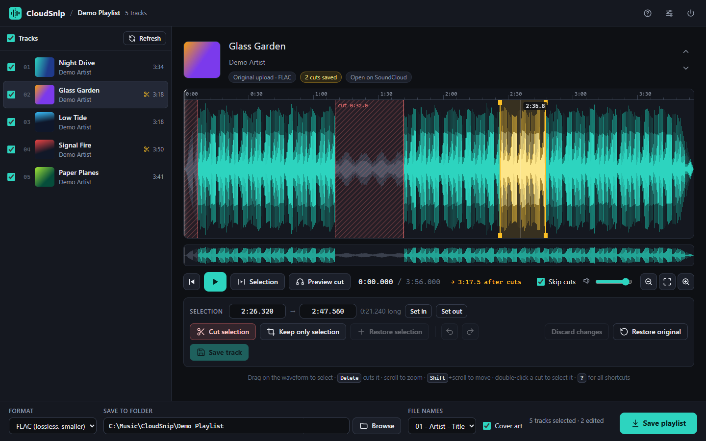

# CloudSnip

**Download, trim and save SoundCloud playlists, all from one window.**

Paste a playlist link and CloudSnip downloads every track at the best quality SoundCloud offers. Cut out the parts you don't want (intros, outros, talking, a drop you hate) on a waveform editor. When it sounds right, press **Save playlist** to write every track to a folder as WAV, FLAC or MP3.

Works on **Windows 10/11** and **Linux** (macOS should work too). It runs locally: a small Python app opens a page in your browser, and nothing is uploaded anywhere.



---

## Quick start

You need **Python 3.10 or newer** ([python.org/downloads](https://www.python.org/downloads/); on Windows tick *"Add python.exe to PATH"* in the installer).

```bash
git clone https://github.com/RaymonDev/cloudsnip.git
cd cloudsnip
```

Then run the one command for your system:

| System  | Command | or |
|---------|---------|----|
| Windows | `py run.py` | double-click **`CloudSnip.bat`** |
| Linux   | `python3 run.py` | `./cloudsnip.sh` |

The first run takes a minute: it creates a private environment in `.venv/` and installs everything it needs, **including ffmpeg**, so there's nothing else to install. Later runs start in a couple of seconds. Your browser opens automatically. If it doesn't, open the address printed in the terminal (normally <http://127.0.0.1:8765>).

To quit, click the power button in the top-right corner, or press `Ctrl+C` in the terminal.

> **Debian / Ubuntu / Mint:** if you get an error about `venv` or `ensurepip`, run `sudo apt install python3-venv` once and try again.

---

## How to use it

1. **Paste a link** and press **Load playlist**. Playlists (sets), albums, single tracks, an artist's page or their likes all work. Private playlists work with their secret share link.
2. Tracks download in the background, three at a time. Click any track that's ready to open it in the editor.
3. **Edit**:
   - **Drag** on the waveform to select a part. Fine-tune it by dragging the yellow edges, typing exact times in the *Selection* boxes, or pressing `I` / `O` while listening to set the start / end at the playhead.
   - **Cut selection** (`Delete`) removes it. **Keep only selection** (`K`) removes everything else.
   - **Preview cut** (`A`) plays the 3 seconds before and after the selection, so you hear exactly how the join will sound before you commit.
   - Removed parts stay visible (red hatching) and are skipped while you play.
   - **Undo / redo** with `Ctrl+Z` / `Ctrl+Shift+Z`.
4. **Save track** (`Ctrl+S`) stores your cuts. The original download is never modified. You can always:
   - **Restore selection** (`R`) to bring back removed audio inside a selection (double-click a cut to select it), or
   - **Restore original** to remove every cut from the track.
5. **Save playlist**: choose a format and a folder, then press the button. Every ticked track is written with its cuts applied, numbered in playlist order, tagged (title, artist, album, track number) and with cover art for FLAC/MP3. An `.m3u8` playlist file is added too.

Untick a track in the list to leave it out of the saved playlist. Title and artist are editable: click them in the editor. They are used for file names and tags.

### Keyboard shortcuts

| Key | Action | Key | Action |
|-----|--------|-----|--------|
| `Space` | Play / pause | `I` / `O` | Selection start / end at playhead |
| `Delete` or `X` | Cut selection | `P` | Play selection |
| `K` | Keep only selection | `A` | Preview the cut |
| `R` | Restore audio in selection | `Esc` | Clear selection |
| `Ctrl+Z` / `Ctrl+Shift+Z` | Undo / redo | `Ctrl+S` | Save track |
| `←` / `→` | Move 1 s (`Shift`: 5 s) | `Home` / `End` | Start / end |
| `+` / `-` / `0` | Zoom in / out / whole track | `↑` / `↓` | Previous / next track |

Mouse: **scroll** to zoom, **Shift+scroll** to move along the track, drag the small overview strip to jump around when zoomed in.

---

## Audio quality

CloudSnip always downloads the **best stream SoundCloud provides** for each track:

1. **The original upload** (often WAV/FLAC/AIFF), when the artist enabled downloads.
2. Otherwise the best streaming format: usually **AAC 160 kbps**, or **AAC 256 kbps** with a Go+ account (see below), falling back to MP3 128 kbps or Opus 64 kbps.

The editor shows which stream each track came from (e.g. *AAC · 160 kbps*).

Export formats:

| Format | What it is | Use it for |
|--------|------------|------------|
| **WAV 24-bit** *(default)* | Uncompressed, no extra loss | DJ software, editing, maximum quality |
| **WAV 16-bit** | CD format, with dither | Older players and CDJs |
| **FLAC** | Lossless and about 40% smaller than WAV, with cover art | Archiving, music players |
| **MP3 320 kbps** | Highest MP3 quality, with cover art | Phones, maximum compatibility |

All formats keep the source's sample rate and channels. Be aware that a lossless format can't add back detail that a lossy stream never had. Saving as WAV or FLAC means *no further* quality is lost, which is the best possible result. Each cut gets a tiny 6 ms fade so joins never click.

### SoundCloud Go+ tracks (optional)

Some tracks only play as 30-second previews without a Go+ subscription. CloudSnip marks those. If you have Go+, you can let CloudSnip use your account:

1. Log in on soundcloud.com in your browser.
2. Open the developer tools (`F12`) → **Application** (Chrome/Edge) or **Storage** (Firefox) → **Cookies** → `https://soundcloud.com`.
3. Copy the value of the `oauth_token` cookie and paste it in CloudSnip's **Settings** (the sliders icon).
4. Press **Retry** on the affected tracks.

The token is stored only on your computer, in `workspace/settings.json`.

A few tracks are only streamed with DRM copy protection. Those can't be downloaded by any tool, and CloudSnip tells you so.

---

## Where things are stored

| What | Where |
|------|-------|
| Saved playlists | The folder you choose. Default: `Music/CloudSnip/<playlist name>/` |
| Downloads, waveforms, your cuts | `workspace/` inside the CloudSnip folder |
| Python environment | `.venv/` inside the CloudSnip folder |

Closing CloudSnip loses nothing: reopen a playlist from the home screen and your cuts (and unfinished downloads) are still there. Delete a playlist from the home screen (trash icon) to free disk space. That never touches playlists you already saved to a folder.

Set the `CLOUDSNIP_WORKSPACE` environment variable to keep the workspace somewhere else, or `CLOUDSNIP_FFMPEG` to use a specific ffmpeg binary.

---

## Troubleshooting

- **Downloads suddenly fail for every track.** SoundCloud changed something. CloudSnip updates its downloader (yt-dlp) automatically every few days; to update right now, run `py run.py --update` (Windows) or `python3 run.py --update` (Linux).
- **"Browse" does nothing on Linux.** The folder picker needs `zenity`, `kdialog` or Tk (`sudo apt install python3-tk`). You can always type the folder path instead.
- **Port already in use.** CloudSnip picks the next free port automatically; use `--port 9000` to choose one.
- **Start without opening the browser:** add `--no-browser`.
- **Start over completely:** delete the `.venv/` folder (reinstalls dependencies) and/or `workspace/` (deletes downloads and cuts).

---

## For developers

```
run.py               launcher: creates .venv, installs requirements, starts the app
cloudsnip/
  __main__.py        local web server startup (python -m cloudsnip)
  server.py          HTTP API + static files (Flask), localhost-only with a per-launch token
  sessions.py        playlist state, download queue, export job, persistence (JSON)
  downloader.py      yt-dlp wrapper
  audio.py           ffmpeg: waveform analysis, previews, export rendering
  util.py            cut-list maths, safe file names
  static/            the UI: plain HTML/CSS/JS, no build step
tests/               python -m unittest discover -s tests -v
```

Edits are non-destructive: each track stores a list of `[start, end]` ranges to remove. Nothing is rendered until export, when ffmpeg trims and concatenates the kept segments (`atrim` + `concat`, with short `afade`s at each join) in a single pass from the original download.

You can also run it without the launcher: `pip install -r requirements.txt` and then `python -m cloudsnip`.

---

## Please be fair to artists

CloudSnip is meant for music you're allowed to keep: your own uploads, tracks artists offer as free downloads, Creative Commons releases, and so on. Respect SoundCloud's [Terms of Use](https://soundcloud.com/terms-of-use) and the copyright laws where you live. Support the artists you love.

CloudSnip is not affiliated with or endorsed by SoundCloud.

## License

[MIT](LICENSE)
